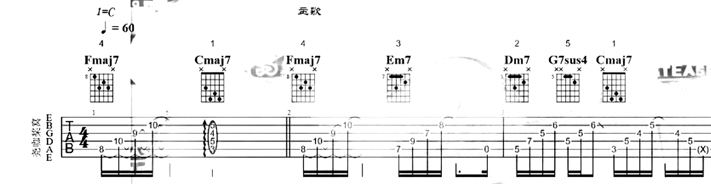

# Guitar Tab Parser

CLI that turns a guitar-lesson video — from YouTube or a local file — into a PDF
of the guitar tab.

It samples frames from the video, locates the tab region (with Claude vision or
a box you give it), crops every frame to that region, keeps each part of the
score exactly once, and stacks the result into a PDF at `out/<title>.pdf`.

## Credits

This project is adapted from
[marcelpanse/youtube-guitar-tab-parser](https://github.com/marcelpanse/youtube-guitar-tab-parser),
which provides the original YouTube → PDF pipeline (download, frame sampling,
vision-based tab detection, bar-number dedup and PDF output).

### What this fork adds

- **Local video support** — `--input <path>` reads a video file you already
  have, in place and at its original resolution. `yt-dlp` is not needed, and the
  PDF is named after the file (or `--title`).
- **Scrolling-score support (stitching)** — `--scroll` handles lessons where
  the notation is overlaid on the video and scrolls sideways. Instead of keeping
  one crop per bar number, overlapping crops are aligned and stitched into one
  panorama, the moving background is removed, and the panorama is cut into rows
  at barlines.
- **Fully offline runs** — with `--box` and `--scroll` together, no Claude calls
  are made and no API key is needed.
- **Time ranges** — `--start` / `--end` process only part of the video, which
  makes it quick to preview settings before a full run.

## Examples

### YouTube lesson (page-by-page score)

Generated from
[Game of Thrones - Guitar Lesson + TAB](https://youtu.be/WgU5tDGC-Vc):

```bash
node --env-file=.env dist/cli.js "https://youtu.be/WgU5tDGC-Vc"
```

- 🎬 Source video: <https://youtu.be/WgU5tDGC-Vc>
- 📄 Output PDF: [examples/Game of Thrones.pdf](examples/Game%20of%20Thrones.pdf)

### Local video (horizontally scrolling score)

Generated from a local recording (`song.mov`, not included in the repo because
of its size) in which white notation scrolls across the video:

```bash
node dist/cli.js --input song.mov --box 0,55,1000,880 --scroll -i 0.5
```

- 📄 Output PDF: [out/song.pdf](out/song.pdf)
- 🧩 Intermediate files: [out/song.parts/](out/song.parts/) — the stitched
  panorama, one image per row, `shifts.txt` and `flags.txt`

First row of the result (white-on-video notation, recovered as a clean score):



## Requirements

- Node.js ≥ 22.12
- [`ffmpeg`](https://ffmpeg.org/) on your `PATH`
- [`yt-dlp`](https://github.com/yt-dlp/yt-dlp) on your `PATH` — only for YouTube URLs
  (`brew install yt-dlp ffmpeg`)
- An Anthropic API key — unless you run with both `--box` and `--scroll`

## Setup

```bash
npm install
npm run build
echo "ANTHROPIC_API_KEY=sk-ant-..." > .env
```

## Usage

### YouTube URL

```bash
# with a .env file
node --env-file=.env dist/cli.js "https://www.youtube.com/watch?v=WgU5tDGC-Vc"

# or with the key already exported
export ANTHROPIC_API_KEY=sk-ant-...
node dist/cli.js "https://www.youtube.com/watch?v=WgU5tDGC-Vc"
```

### Local video file

Pass `--input` instead of a URL. Paths with spaces or Unicode work as long as
they are quoted.

```bash
node --env-file=.env dist/cli.js --input "/path/to/my lesson.mp4"
```

### Horizontally scrolling score

Some lessons overlay white notation on the video and scroll the score sideways.
There the leftmost bar number stays the same while new measures enter on the
right, so the default bar-number dedup drops or repeats measures. Use
`--scroll` to stitch instead. Combined with a manual `--box` (read off a frame
you inspected, in 0–1000 coordinates), no API key is needed:

```bash
# preview a short range first, then drop --start/--end for the whole video
node dist/cli.js --input "/path/to/video.mov" --box 0,55,1000,880 --scroll -i 0.5 --start 10 --end 30
```

Next to the PDF, `out/<title>.parts/` keeps the stitched panorama, the row
images, `shifts.txt` (the measured scroll per frame) and `flags.txt` (sections
with timestamps where the background could not be fully separated, frames
without a staff, or alignment breaks). Check those spots against the video.

### Output

The PDF path is printed to stdout; progress goes to stderr. During development
you can skip the build step:

```bash
node --env-file=.env --import tsx src/cli.ts "<url>"
```

## Options

Everything has a sensible default; you normally only need the URL or `--input`.

```
-i, --interval <seconds>   screenshot interval (default 2)
--input <path>             local video file instead of a URL (no download)
--title <text>             override the PDF title / file name
--box <x0,y0,x1,y1>        tab region in 0–1000 coords; skips vision detection
--scroll                   stitch a horizontally scrolling score (no bar-number dedup)
--row-width <px>           target PDF row width in source pixels for --scroll (default 2000)
--start <s> / --end <s>    only process this time range of the video
--model <id>               Claude vision model (default claude-sonnet-5)
--sample <n>               frames sampled for tab-region detection (default 6)
--dedup-threshold <n>      pre-dedup Hamming distance, cost control (default 12)
--max-height <px>          cap download resolution (default 720)
--keep-temp                keep intermediate frames/crops
```

An Anthropic API key is only required for vision detection (no `--box`) and
for bar-number dedup (no `--scroll`).

## How it works

1. **Source** — `yt-dlp` downloads the video (≤ `--max-height`), or, with
   `--input`, the local file is used in place.
2. **Frames** — `ffmpeg` extracts one frame every `--interval` seconds, within
   `--start`/`--end` if given.
3. **Detect** — skipped when `--box` is given. Otherwise two stages, since
   vision models are reliable at picking labeled regions but not at precise
   pixel coordinates:
   - A labeled row/column grid is drawn on `--sample` frames and Claude vision
     reports which rows and columns the sheet music overlaps. The per-edge median
     across samples gives a coarse box.
   - That box is snapped to the actual paper edges with an image mask (dark
     content on a light, unsaturated background), so the crop hugs the tab. If no
     clear paper region is found, the vision box is used.
4. **Crop** — `sharp` crops every frame to that box.
5. **Keep each part of the score once** — one of two strategies:
   - **Bar-number dedup** (default, for scores that turn page by page). A dHash
     pre-dedup first drops near-identical consecutive crops to save vision
     calls. Claude then reads the bar number at the start of each line; one crop
     per distinct bar number is kept and non-tab crops (title cards, intros) are
     dropped.
   - **Stitching** (`--scroll`, for scores that scroll sideways). Each crop is
     reduced to a "notation" channel (bright, unsaturated pixels). The horizontal
     shift between consecutive crops is measured by correlating thin notation
     strokes only, so staff lines, the performer and fixed screen elements don't
     mislead the alignment. All crops are placed on one wide canvas, and a
     per-pixel low percentile across overlapping crops keeps the notation while
     removing the moving background, playhead and highlight boxes. The panorama
     is then cut into rows of about `--row-width` pixels at barlines.
6. **PDF** — `pdf-lib` stacks the tab lines down A4 pages in video order. The
   title (video title, file name, or `--title`) becomes the file name, a heading
   on the first page and the document metadata title.

## License

See [LICENSE](LICENSE).
